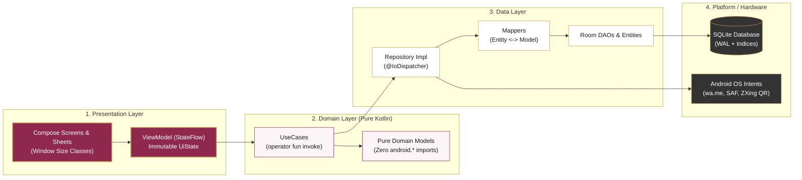
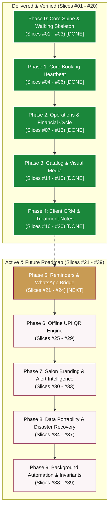
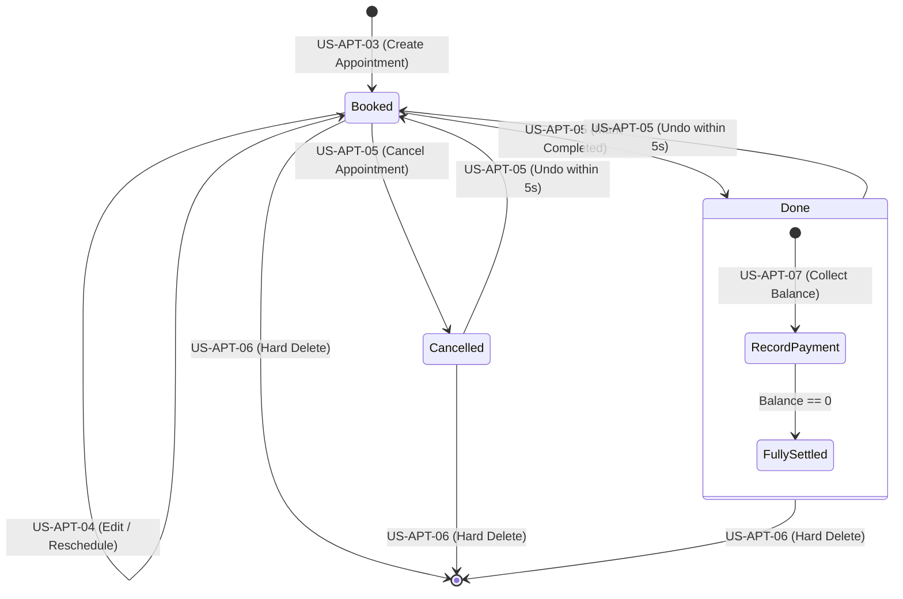
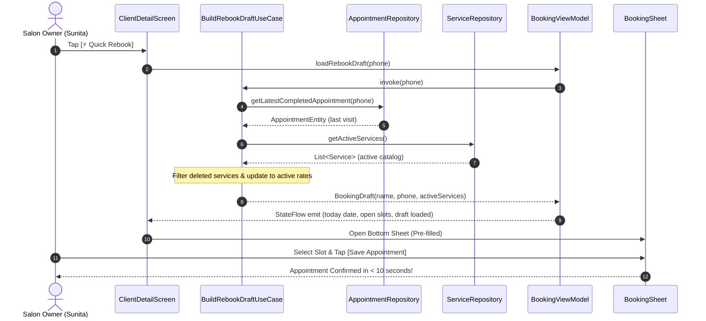
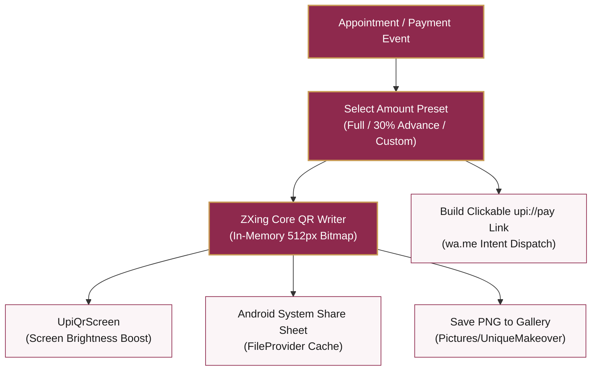
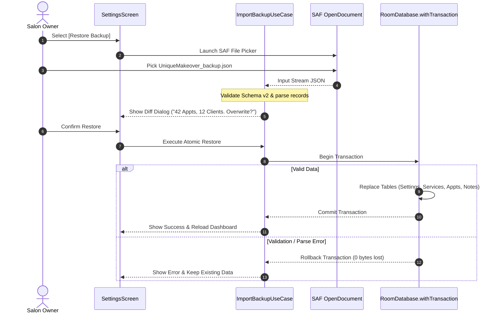

# Unique Makeover Admin Console — Full Architectural Journey & Vertical Slice Roadmap
### Native Android · 100% Offline · Clean Architecture · Jalgaon Jamod Boutique Salon
**Document Version:** 1.0.0  
**Current Milestone:** Phase 4 Completed (20 of 39 Vertical Slices Delivered — 51.3% Complete)  
**Authoritative References:** [`docs/ARD.md`](file:///home/shunya/Projects/uniqmaleoveradmin/docs/ARD.md), [`docs/FRD.md`](file:///home/shunya/Projects/uniqmaleoveradmin/docs/FRD.md), [`desing.md`](file:///home/shunya/Projects/uniqmaleoveradmin/desing.md), [`vertical-slice-indexmap.md`](file:///home/shunya/Projects/uniqmaleoveradmin/vertical-slice-indexmap.md)

---

## 1. Executive Summary & Architecture Philosophy

The **Unique Makeover Admin Console** is a specialized native Android application engineered exclusively for a luxury boutique beauty parlour in Jalgaon Jamod. Built under a strict **Offline-First Zero-Network Mandate**, the application guarantees absolute operational privacy, instantaneous (<15 ms) SQLite queries, zero recurring cloud costs, and complete resilience against local connectivity outages.

### The Vertical Slice Law:
Rather than scaffolding horizontal layers across months of development, each user story cuts cleanly through all architectural tiers:
```
Compose UI (M3) ──► ViewModel (StateFlow) ──► Pure Domain UseCase ──► Data Repository / DAO ──► Room SQLite / Android Hardware Intent
```



---

## 2. High-Level Master App Journey Roadmap

The 39 user stories are organized into **10 sequential phases (Phases 0 through 9)**. Phases 0 through 4 are **100% completed and verified** on physical hardware (Vivo 1811).



---

## 3. Comprehensive Phase-by-Phase Journey Breakdown

### Phase 0: Core Spine & Walking Skeleton (Slices #01 – #03) — `COMPLETED`
* **Goal:** Establish local SQLite persistence with Room WAL mode, pre-populate default salon services, and lock unauthorized entry behind an offline PIN gate.
* **Vertical Slices:**
  * **Slice #01 (`US-SYS-03`):** Room SQLite Database, composite indices `(date, time)`, `(phone)`, and WAL concurrency mode.
  * **Slice #02 (`US-SVC-01`):** Service Catalog Browsing & Seed Data Initialization (7 default treatments: Haircut, Facial, Keratin Spa, etc.).
  * **Slice #03 (`US-AUTH-01`):** Cold-start PIN Verification Gate (`1234` default) with encrypted storage and custom keypad.

---

### Phase 1: Core Booking Heartbeat (Slices #04 – #06) — `COMPLETED`
* **Goal:** Implement the conflict-free appointment booking engine.
* **Vertical Slices:**
  * **Slice #04 (`US-SET-02`):** Business Operating Hours (10:00 AM – 08:00 PM), configurable slot duration (30 mins), and staff roster.
  * **Slice #05 (`US-APT-02`):** Conflict-Free Manual Booking & Dynamic Slot Generation with past-time disabling and real-time clash checks.
  * **Slice #06 (`US-APT-03`):** Multi-Service Selection, real-time subtotal computation, custom discounts, and advance payment recording.

---

### Phase 2: Operations & Financial Cycle (Slices #07 – #13) — `COMPLETED`
* **Goal:** Real-time parlour schedule feed, status transitions, in-line payments, and appointment management.
* **Vertical Slices:**
  * **Slice #07 (`US-APT-01`):** Filtered Appointment Directory with tab filters (All/Upcoming/Completed/Cancelled) and substring search.
  * **Slice #08 (`US-DASH-01`):** Real-Time Operational & Financial KPIs (Today's Bookings, Revenue Collected, Balance Due).
  * **Slice #09 (`US-DASH-03`):** Today's Live Schedule Stream with chronological row cards and inline action shortcuts.
  * **Slice #10 (`US-APT-05`):** Status Lifecycle Transitions (`booked` $\rightarrow$ `done` / `cancel`) with 5-second transient Undo snackbar.
  * **Slice #11 (`US-APT-07`):** In-line Payment Recording (Cash/UPI) with overpayment safety guard.
  * **Slice #12 (`US-APT-04`):** Rescheduling & Conflict-Aware Editing with self-exclusion clash validation.
  * **Slice #13 (`US-APT-06`):** Hard Deletion of Appointment with confirmation dialog and atomic Room `@Transaction`.



---

### Phase 3: Service Catalog & Visual Media (Slices #14 – #15) — `COMPLETED`
* **Goal:** Enable salon customization with custom services and compressed reference hair/makeup photos.
* **Vertical Slices:**
  * **Slice #14 (`US-SVC-02`):** Service Catalog CRUD with snapshot safety (catalog edits never mutate past appointments).
  * **Slice #15 (`US-SVC-03`):** Camera & Gallery photo capture with downscaling to 320 px @ 78% JPEG in local app storage (`filesDir/images`).

---

### Phase 4: Client CRM & Treatment Notes (Slices #16 – #20) — `COMPLETED`
* **Goal:** Automated client intelligence synthesized from visit histories, private skin/hair allergy notes, and 1-tap rebooking.
* **Vertical Slices:**
  * **Slice #16 (`US-CRM-01`):** Client Directory & Automated History Aggregation (`GROUP BY phone` SQLite aggregation).
  * **Slice #17 (`US-CRM-02`):** Instant Client Search by Name or 10-Digit Mobile Number with 150ms debounce.
  * **Slice #18 (`US-CRM-03`):** Detailed Client Profile with lifetime metrics (Total Spend, Visits) and reverse-chronological history.
  * **Slice #19 (`US-CRM-04`):** Private Confidential Notes with 500ms debounced autosave and immediate flush on exit.
  * **Slice #20 (`US-CRM-05`):** 1-Tap Quick Rebooking Pre-Fill (pre-populates booking sheet with last avail services at current catalog pricing).



---

### Phase 5: Reminders & WhatsApp Bridge (Slices #21 – #24) — `UPCOMING NEXT`
* **Goal:** Automate day-before reminder dispatches via offline WhatsApp intents with zero recurring SMS or server costs.
* **Vertical Slices:**
  * **Slice #21 (`US-SET-03`):** Communication Settings (Salon WhatsApp contact & UPI configuration with regex verification).
  * **Slice #22 (`US-REM-03`):** Dynamic Reminder Template Token Substitution (`{name}`, `{service}`, `{time}`, etc.) with live preview card.
  * **Slice #23 (`US-REM-01`):** Tomorrow's Reminder Queue Monitoring (filters unreminded bookings for next day).
  * **Slice #24 (`US-REM-02`):** 1-Tap Offline WhatsApp Dispatch (`ACTION_VIEW` targeting `wa.me`) with optimistic status update and Undo.

---

### Phase 6: Offline UPI QR Code Engine (Slices #25 – #29) — `PLANNED`
* **Goal:** Instant on-screen UPI QR generation with preset calculations (30% advance, full balance) and offline image export.
* **Vertical Slices:**
  * **Slice #25 (`US-UPI-05`):** Missing UPI Configuration Guard Banner.
  * **Slice #26 (`US-UPI-01`):** Dynamic Offline UPI QR Generation using in-memory **ZXing Core** (`QRCodeWriter`) at 512px.
  * **Slice #27 (`US-UPI-02`):** Payment Amount Presets (Full Balance, 30% Advance with integer rounding).
  * **Slice #28 (`US-UPI-03`):** WhatsApp Direct `upi://pay` Payment Link Dispatch.
  * **Slice #29 (`US-UPI-04`):** QR PNG Export via MediaStore & Android System Share Sheet.



---

### Phase 7: Salon Branding & Alert Intelligence (Slices #30 – #33) — `PLANNED`
* **Goal:** Aesthetic salon personalization, connected dashboard alert banners, and security hardening.
* **Vertical Slices:**
  * **Slice #30 (`US-SET-01`):** Salon Branding Setup (200px circular logo crop & optional luxury wallpaper).
  * **Slice #31 (`US-DASH-02`):** Actionable System Alert Banners on Dashboard with deep navigation links.
  * **Slice #32 (`US-AUTH-02`):** Brute-Force Rate Limiting & Lockout Policy (5 failed attempts trigger 30s hardware timer).
  * **Slice #33 (`US-AUTH-03`):** In-App Admin PIN Modification with current PIN authentication.

---

### Phase 8: Data Portability & Disaster Recovery (Slices #34 – #37) — `PLANNED`
* **Goal:** Atomic full-database JSON backups via Android Storage Access Framework (SAF), diff previews, and safe factory reset.
* **Vertical Slices:**
  * **Slice #34 (`US-DAT-01`):** Full Database JSON Export via SAF `CreateDocument`.
  * **Slice #35 (`US-DAT-02`):** Atomic Backup Import with Diff Preview & automatic transaction rollback on schema mismatch.
  * **Slice #36 (`US-DAT-03`):** Overdue Backup Warning (> 3 days).
  * **Slice #37 (`US-DAT-04`):** Factory Reset / Clear All Local Data protected by PIN challenge.



---

### Phase 9: Background Automation & Invariants (Slices #38 – #39) — `PLANNED`
* **Goal:** Scheduled local notifications and zero-network security assertion.
* **Vertical Slices:**
  * **Slice #38 (`US-SYS-01`):** Daily 8:00 PM Local Reminder Notification via Android `WorkManager` (prompts owner if tomorrow's queue is unreminded).
  * **Slice #39 (`US-SYS-02`):** Zero-Network Strict Offline Invariant Audit (100% offline verification in Airplane Mode; CI check asserting zero `INTERNET` permission).

---

## 4. Master Slice Execution Matrix (1 to 39)

| Index | Story ID | Story Title | Phase | Target Layer | Status |
|:---:|:---:|---|:---:|:---:|:---:|
| **#01** | `US-SYS-03` | Room SQLite Database, Indices & WAL Concurrency | Phase 0 | Database / Data | ✅ **Complete** |
| **#02** | `US-SVC-01` | Service Catalog Browsing & Seed Data Initialization | Phase 0 | Catalog / Domain | ✅ **Complete** |
| **#03** | `US-AUTH-01` | Cold-Start PIN Verification Gate | Phase 0 | Auth / Presentation | ✅ **Complete** |
| **#04** | `US-SET-02` | Business Operating Hours, Slot Duration & Staff | Phase 1 | Settings / Data | ✅ **Complete** |
| **#05** | `US-APT-02` | Conflict-Free Manual Booking & Dynamic Slot Generation | Phase 1 | Booking / Domain | ✅ **Complete** |
| **#06** | `US-APT-03` | Multi-Service Selection, Real-Time Subtotal & Advance | Phase 1 | Booking / Presentation | ✅ **Complete** |
| **#07** | `US-APT-01` | Filtered Appointment Directory & Substring Search | Phase 2 | Directory / Data | ✅ **Complete** |
| **#08** | `US-DASH-01` | Real-Time Operational & Financial KPIs | Phase 2 | Dashboard / Domain | ✅ **Complete** |
| **#09** | `US-DASH-03` | Today's Live Schedule Stream & Quick Actions | Phase 2 | Dashboard / Presentation | ✅ **Complete** |
| **#10** | `US-APT-05` | Status Lifecycle Transitions & Accidental Tap Undo | Phase 2 | Appointments / Domain | ✅ **Complete** |
| **#11** | `US-APT-07` | In-line Payment Recording & Overpayment Guard | Phase 2 | Payments / Data | ✅ **Complete** |
| **#12** | `US-APT-04` | Rescheduling & Conflict-Aware Editing | Phase 2 | Booking / Domain | ✅ **Complete** |
| **#13** | `US-APT-06` | Hard Deletion of Appointment with Guardrail | Phase 2 | Appointments / Data | ✅ **Complete** |
| **#14** | `US-SVC-02` | Service Catalog CRUD with Snapshot Safety | Phase 3 | Catalog / Data | ✅ **Complete** |
| **#15** | `US-SVC-03` | Service Reference Photo & Local 320px Compression | Phase 3 | Media / Platform | ✅ **Complete** |
| **#16** | `US-CRM-01` | Client Directory & Automated History Aggregation | Phase 4 | CRM / Data | ✅ **Complete** |
| **#17** | `US-CRM-02` | Instant Client Search by Name or Mobile | Phase 4 | CRM / Presentation | ✅ **Complete** |
| **#18** | `US-CRM-03` | Detailed Client History & Lifetime Metrics | Phase 4 | CRM / Presentation | ✅ **Complete** |
| **#19** | `US-CRM-04` | Private Client Skin & Hair Notes with Autosave | Phase 4 | Notes / Domain | ✅ **Complete** |
| **#20** | `US-CRM-05` | 1-Tap Quick Rebooking Pre-Fill | Phase 4 | Booking / Domain | ✅ **Complete** |
| **#21** | `US-SET-03` | Communication Settings (WhatsApp & UPI Config) | Phase 5 | Settings / Domain | ⏳ **Upcoming Next** |
| **#22** | `US-REM-03` | Dynamic Reminder Template Substitution & Preview | Phase 5 | Reminders / Domain | 📋 Planned |
| **#23** | `US-REM-01` | Tomorrow's Reminder Queue Monitoring | Phase 5 | Reminders / Presentation | 📋 Planned |
| **#24** | `US-REM-02` | 1-Tap Offline WhatsApp Dispatch & Optimistic Status | Phase 5 | Reminders / Platform | 📋 Planned |
| **#25** | `US-UPI-05` | Missing UPI Configuration Guard Banner | Phase 6 | UPI / Presentation | 📋 Planned |
| **#26** | `US-UPI-01` | Dynamic Offline UPI QR Generation (ZXing Core) | Phase 6 | UPI / Platform | 📋 Planned |
| **#27** | `US-UPI-02` | Payment Amount Preset Calculations (30% Advance) | Phase 6 | UPI / Domain | 📋 Planned |
| **#28** | `US-UPI-03` | WhatsApp Direct UPI Payment Link Dispatch | Phase 6 | UPI / Platform | 📋 Planned |
| **#29** | `US-UPI-04` | QR Code Image Export & Native Share Sheet | Phase 6 | UPI / Platform | 📋 Planned |
| **#30** | `US-SET-01` | Salon Branding Setup (Logo Crop & Wallpaper) | Phase 7 | Settings / Data | 📋 Planned |
| **#31** | `US-DASH-02` | Actionable System Alert Banners & Deep Linking | Phase 7 | Dashboard / Domain | 📋 Planned |
| **#32** | `US-AUTH-02` | Brute-Force Rate Limiting & Lockout Policy | Phase 7 | Auth / Domain | 📋 Planned |
| **#33** | `US-AUTH-03` | Admin PIN Modification with Existing Validation | Phase 7 | Settings / Domain | 📋 Planned |
| **#34** | `US-DAT-01` | Full Database JSON Export via SAF | Phase 8 | Data / Platform | 📋 Planned |
| **#35** | `US-DAT-02` | Atomic Backup Import with Diff Preview & Rollback | Phase 8 | Data / Data | 📋 Planned |
| **#36** | `US-DAT-03` | Overdue Backup Detection & Warning | Phase 8 | Settings / Domain | 📋 Planned |
| **#37** | `US-DAT-04` | Factory Reset / Clear All Data with Guardrail | Phase 8 | Data / Domain | 📋 Planned |
| **#38** | `US-SYS-01` | Daily 8:00 PM Local Reminder Notification | Phase 9 | System / WorkManager | 📋 Planned |
| **#39** | `US-SYS-02` | Zero-Network Strict Offline Enforcement | Phase 9 | Security / Invariant | 📋 Planned |

---

## 5. Architectural Invariants Enforced

Throughout all completed and future slices, the application enforces these 5 architectural laws:
1. **Zero Internet Permission:** `AndroidManifest.xml` never contains `<uses-permission android:name="android.permission.INTERNET" />`.
2. **Pure Domain Isolation:** `domain/` contains zero imports of `android.*`, `androidx.*`, or Room annotations.
3. **No SQLite Blobs for Photos:** Images are compressed to 320 px @ 78% JPEG on disk (`filesDir/images/*.jpg`). Room only stores relative path strings.
4. **Reactive Single Source of Truth:** Room Flow streams query updates directly into ViewModels; state is exposed as immutable `StateFlow<UiState>`.
5. **Atomic Data Operations:** Multi-table mutations, status undos, and backup restorations always execute inside `RoomDatabase.withTransaction`.

---
**End of Full App Journey & Vertical Slice Roadmap — Unique Makeover Admin Console**
