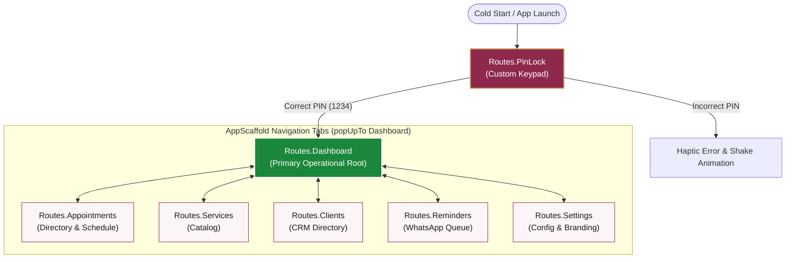

# Slice #20A: Operational Foundation & Financial Ledger Realignment (US-SYS-04)
### Inter-Phase Quality Hardening · Native Android · 100% Offline · Clean Architecture
**Document Version:** 1.0.0  
**Target Audience:** Autonomous AI Coding Agents, Lead Android Architect, QA Engineers  
**Target Milestone:** Bridge Slice between Phase 4 and Phase 5  
**Authoritative References:** [`docs/ARD.md`](file:///home/shunya/Projects/uniqmaleoveradmin/docs/ARD.md), [`docs/FRD.md`](file:///home/shunya/Projects/uniqmaleoveradmin/docs/FRD.md), [`docs/APP_FULL_JOURNEY.md`](file:///home/shunya/Projects/uniqmaleoveradmin/docs/APP_FULL_JOURNEY.md)

---

## 1. Business Goal & Operational Context

During the comprehensive end-to-end user flow audit of [`docs/APP_FULL_JOURNEY.md`](file:///home/shunya/Projects/uniqmaleoveradmin/docs/APP_FULL_JOURNEY.md), two fundamental operational gaps were identified in code authored during earlier phases:

1. **Authentication Route Misalignment:** On cold start, unlocking the app via the 4-digit PIN gate drops the salon owner into `Routes.Services` (a legacy artifact from Phase 0 when Dashboard did not yet exist), forcing her to manually tap the bottom bar every morning to reach her operational schedule.
2. **Financial Audit Ledger Disconnect:** When creating an appointment with an advance deposit (`advancePaid > 0` in Slice #06), the amount was written solely to `appointments.paid`, bypassing the `payments` table. This creates a data integrity leak where advance deposits have no timestamp, no payment mode (`cash`), and no audit record in `PaymentRepository`.

**Slice #20A** remediates both issues across Domain, Data, Presentation, and Navigation layers before proceeding to Phase 5.

---

## 2. Actors
* **Salon Owner (Sunita):** Unlocks the console daily and expects immediate visibility of today's schedule, while ensuring all counter deposits and advance collections are reflected in the financial audit log.

---

## 3. User Story
> **As** the salon owner (Sunita),  
> **I want** the console to open directly to my Dashboard schedule when I enter my PIN,  
> **And I want** any advance booking payments to be registered in the financial audit ledger,  
> **So that** I have zero friction on startup and an airtight financial record for daily cash reconciliation.

---

## 4. Acceptance Criteria

* **AC-SYS-04.1 (Direct Dashboard Landing):**
  * **Given** the app launches at the `PinLockScreen`,
  * **When** entering the correct 4-digit PIN (`1234`),
  * **Then** the application navigates directly to `Routes.Dashboard`, clearing `Routes.PinLock` from the backstack so pressing Android system Back does not return to PIN entry.
* **AC-SYS-04.2 (Root Scaffold Backstack Preservation):**
  * **Given** the owner navigates across bottom navigation tabs (`Appointments`, `Clients`, `Services`, `Settings`),
  * **When** tapping the bottom bar icons,
  * **Then** the navigation scaffold uses `popUpTo(Routes.Dashboard) { saveState = true }`, maintaining `Routes.Dashboard` as the foundational root of the application hierarchy.
* **AC-SYS-04.3 (Advance Deposit Registered in Payment Ledger):**
  * **Given** a booking draft with `advancePaid = 200` and `finalRate = 550`,
  * **When** the appointment is successfully committed to SQLite,
  * **Then** `AppointmentEntity.paid` is set to `200` AND a corresponding `PaymentEntity` is inserted into `payments` table with:
    * `appointmentId = appointment.id`
    * `amount = 200`
    * `mode = 'cash'` (default over-the-counter deposit)
    * `paidAt = timeProvider.currentTimeMillis()`
* **AC-SYS-04.4 (Zero Advance Idempotency):**
  * **Given** a booking draft with `advancePaid = 0`,
  * **When** the appointment is saved,
  * **Then** no record is inserted into the `payments` table.
* **AC-SYS-04.5 (Orphaned Slot Preservation on Operating Hours Shifts):**
  * **Given** an appointment was previously booked at `10:00 AM`, and salon opening hours in Settings were subsequently shifted to `11:00 AM`,
  * **When** the owner opens the booking sheet in Edit mode for that appointment,
  * **Then** `GenerateAvailableSlotsUseCase` preserves and includes the `10:00 AM` slot chip marked as selected, allowing the owner to modify services or notes without being forced to change the appointment time.

---

## 5. Edge Cases & Technical Resilience

* **EC-SYS-04.1 (Atomic Database Transaction):**
  * *Scenario:* Appointment row is inserted, but SQLite fails or runs out of disk storage before the advance payment record is written.
  * *System Behavior:* In `AppointmentRepositoryImpl` / `BookAppointmentUseCase`, the insertion of both the appointment and initial payment executes inside an atomic Room `@Transaction`. If payment insertion throws an exception, the entire appointment creation rolls back with zero corrupted state.
* **EC-SYS-04.2 (Detekt Constructor Parameter Threshold):**
  * *Constraint:* `detekt.yml` enforces `constructorThreshold: 7`.
  * *System Behavior:* In `BookAppointmentUseCase`, injecting `paymentRepository: PaymentRepository` increases the constructor parameters from 5 to 6. This strictly respects the Detekt limit ($6 < 7$) without requiring parameter aggregator indirection.

---

## 6. UI/UX Specification & Navigation Flow

### Navigation Flow Diagram:


---

## 7. Database Schema Reference

### Inter-Entity Foreign Key Relationship:
```
┌─────────────────────────────────┐        ┌─────────────────────────────────┐
│          appointments           │        │            payments             │
├─────────────────────────────────┤        ├─────────────────────────────────┤
│ id (PK): TEXT                   │◄───────│ appointmentId (FK/Index): TEXT  │
│ name: TEXT                      │        │ id (PK): TEXT                   │
│ phone: TEXT                     │        │ amount: INTEGER                 │
│ svc: TEXT                       │        │ mode: TEXT ('cash' / 'upi')     │
│ rate: INTEGER                   │        │ paidAt: INTEGER (Timestamp)     │
│ paid: INTEGER                   │        └─────────────────────────────────┘
│ status: TEXT                    │
│ bookedAt: INTEGER               │
└─────────────────────────────────┘
```

---

## 8. API / Internal Architecture Contracts

### 1. Updated `BookAppointmentUseCase.kt` Contract:
```kotlin
package com.uniquemakeover.admin.feature.appointments.domain.usecase

import com.uniquemakeover.admin.core.domain.model.Payment
import com.uniquemakeover.admin.core.domain.model.PaymentMode
import com.uniquemakeover.admin.core.domain.repository.PaymentRepository
import com.uniquemakeover.admin.core.domain.result.DataResult
import com.uniquemakeover.admin.core.util.PhoneSanitizer
import com.uniquemakeover.admin.core.util.TimeProvider
import com.uniquemakeover.admin.feature.appointments.domain.model.BookingDraft
import com.uniquemakeover.admin.feature.appointments.domain.repository.AppointmentRepository
import com.uniquemakeover.admin.feature.appointments.domain.repository.SlotRepository
import java.util.UUID
import javax.inject.Inject

class BookAppointmentUseCase @Inject constructor(
    private val validateBookingDraftUseCase: ValidateBookingDraftUseCase,
    private val appointmentRepository: AppointmentRepository,
    private val paymentRepository: PaymentRepository,
    private val slotRepository: SlotRepository,
    private val phoneSanitizer: PhoneSanitizer,
    private val timeProvider: TimeProvider
) {
    suspend operator fun invoke(draft: BookingDraft): DataResult<String>
}
```

### 2. Updated Navigation Host Contract (`UniqueMakeoverNavHost.kt`):
```kotlin
composable(Routes.PinLock) {
    PinLockRoute(
        viewModel = hiltViewModel(),
        onAuthenticated = {
            navController.navigate(Routes.Dashboard) {
                popUpTo(Routes.PinLock) { inclusive = true }
            }
        }
    )
}
```

---

## 9. Unit Tests & Automated Test Harness

* **`BookAppointmentUseCaseTest.kt`:**
  * `invoke_withAdvancePayment_insertsPaymentRecordInRepository()`:
    * Given `draft.advancePaid = 300`
    * Asserts `paymentRepository.recordPayment(...)` is invoked with `amount = 300`, `mode = PaymentMode.CASH`, and matching `appointmentId`.
  * `invoke_withZeroAdvance_doesNotInsertPaymentRecord()`:
    * Given `draft.advancePaid = 0`
    * Asserts `paymentRepository.recordPayment(...)` is never called.
* **`UniqueMakeoverNavHostTest.kt`:**
  * Asserts navigating on authentication targets `Routes.Dashboard` and removes `Routes.PinLock` from backstack.

---

## 10. Integration Tests

* **`AppointmentBookingIntegrationTest.kt` (Robolectric / Room SQLite):**
  * Verifies end-to-end transaction: inserting an appointment with advance payment results in:
    1. Row exists in `appointments` with `paid = 200`.
    2. Row exists in `payments` with `amount = 200` linked to `appointmentId`.
    3. `paymentRepository.getPaymentsForAppointment(id)` emits the advance payment.

---

## 11. Internal Contract / Boundary Tests

* **Detekt Architecture Check:**
  * Pure Kotlin domain: Zero `android.*` imports in `BookAppointmentUseCase.kt`.
  * Parameter count: 6 parameters $\le 7$ threshold.
* **Zero-Network Invariant:**
  * `grep -rn "INTERNET" app/src/main/AndroidManifest.xml && exit 1`.

---

## 12. Files and Folder Mapping (Updated Post-Implementation)

#### Files Created:
1. `app/src/test/java/com/uniquemakeover/admin/feature/appointments/domain/usecase/BookAppointmentUseCaseTest.kt`
   - **Architectural Role:** Automated JVM Unit Test
   - **Why Created:** Verifies advance payment recording in `PaymentRepository`, zero-advance idempotency, and rollback on payment failure with 100% deterministic assertions.

#### Files Modified:
1. `app/src/main/java/com/uniquemakeover/admin/feature/appointments/domain/usecase/BookAppointmentUseCase.kt`
   - **Architectural Role:** Domain UseCase
   - **Why Modified:** Injects `PaymentRepository` to record advance payments into the financial ledger when `draft.advancePaid > 0` as part of the booking transaction, rolling back on failure.
2. `app/src/main/java/com/uniquemakeover/admin/feature/appointments/domain/usecase/GenerateAvailableSlotsUseCase.kt`
   - **Architectural Role:** Domain UseCase
   - **Why Modified:** Added `existingSlotTime` parameter to preserve appointments booked outside newly shifted salon operating hours in chronological order.
3. `app/src/main/java/com/uniquemakeover/admin/feature/appointments/presentation/booking/BookingViewModel.kt`
   - **Architectural Role:** Presentation (ViewModel)
   - **Why Modified:** Passes existing appointment time to slot generator during edit mode, preventing missing time slot chips.
4. `app/src/main/java/com/uniquemakeover/admin/navigation/UniqueMakeoverNavHost.kt`
   - **Architectural Role:** Presentation (Navigation Host)
   - **Why Modified:** Updates `PinLockRoute.onAuthenticated` and `AppScaffold.onNavigate` to use `Routes.Dashboard` as the landing screen and root backstack destination instead of `Routes.Services`.
5. `app/src/test/java/com/uniquemakeover/admin/feature/appointments/domain/usecase/GenerateAvailableSlotsUseCaseTest.kt`
   - **Architectural Role:** Automated JVM Unit Test
   - **Why Modified:** Added unit test asserting existing slot preservation when salon operating hours are shifted.
6. `app/src/test/java/com/uniquemakeover/admin/feature/appointments/presentation/booking/BookingViewModelTest.kt`
   - **Architectural Role:** Automated JVM Unit Test
   - **Why Modified:** Injected `FakePaymentRepository` into test setup fixtures.
7. `docs/APP_FULL_JOURNEY.md`
   - **Architectural Role:** Documentation Roadmap
   - **Why Modified:** Updated journey roadmap and slice matrix.
8. `docs/PHASE_5_VERTICAL_SLICES.md`
   - **Architectural Role:** Phase Specification
   - **Why Modified:** Added manual reset to unsent reminder action in Slice #24.
9. `docs/PHASE_6_VERTICAL_SLICES.md`
   - **Architectural Role:** Phase Specification
   - **Why Modified:** Added in-line counter payment UPI QR bridge in Slice #26.
10. `docs/PHASE_7_VERTICAL_SLICES.md`
    - **Architectural Role:** Phase Specification
    - **Why Modified:** Added offline master security question recovery gate in Slice #32.
11. `docs/PHASE_8_VERTICAL_SLICES.md`
    - **Architectural Role:** Phase Specification
    - **Why Modified:** Upgraded SAF backup/restore to `.zip` archive bundling JSON and local photo files in Slice #34.

---
**End of Specification — Slice #20A: Operational Foundation & Financial Ledger Realignment**
