# Unique Makeover — Admin Console
# Vertical Slice Development Index Map
### Native Android App · Fully Offline · Clean Architecture · Single Location (Jalgaon Jamod)
**Document Version:** 1.0  
**Target Roles:** Veteran Business Analyst, Product Designer, Android System Architect  
**Source References:** `docs/FRD.md` (v2.0), `docs/ARD.md` (v1.0), `docs/USER_STORIES.md` (v2.0)

---

## 1. Executive Summary & Vertical Slice Philosophy

In high-reliability native Android development under Clean Architecture (Presentation $\rightarrow$ Domain $\rightarrow$ Data), building horizontally (e.g., all Room entities first, then all ViewModels, then all UI) produces a delayed integration cliff where hidden edge cases and UX flaws emerge late.

Instead, this development plan organizes all **39 User Stories** into **10 Sequential Vertical Slices (Phases 0 through 9)**. Each vertical slice delivers a fully functional, testable slice spanning:
```
Compose Screen/Sheet ──► ViewModel (StateFlow) ──► Pure Domain UseCase ──► Repository/DAO (Room/SQLite) ──► Hardware/Platform Intent
```

### Development Ordering Principles:
1. **The Walking Skeleton First:** Establish local persistence, default seed catalog, and the primary entry gate before anything else.
2. **Heartbeat of the Business:** Manual booking and conflict-free slot generation drive all downstream data (KPIs, CRM, Reminders, and Billing). It must be built and validated early.
3. **Reactive Consumer Flow:** Build data creators before data aggregators (e.g., Appointments before Dashboard KPIs; Appointments before Client CRM).
4. **Platform & Intent Isolation:** Local Room operations precede external Android Intents (`wa.me`, SAF Document trees, ZXing Bitmaps, MediaStore).
5. **Security & Recovery Last Line of Defense:** Backup export/import and lockout policies wrap a finalized database schema.

---

## 2. Dependency Graph & Phase Overview

```mermaid
flowchart TD
    subgraph P0["Phase 0: Core Spine & Walking Skeleton"]
        S01["#1 US-SYS-03: Room SQLite, WAL & Concurrency"]
        S02["#2 US-SVC-01: Seed Catalog Callback"]
        S03["#3 US-AUTH-01: Cold-Start PIN Gate"]
    end

    subgraph P1["Phase 1: Core Booking Heartbeat"]
        S04["#4 US-SET-02: Business Operating Hours & Staff"]
        S05["#5 US-APT-02: Slot Engine & Clash Checker"]
        S06["#6 US-APT-03: Multi-Service Booking & Advance"]
    end

    subgraph P2["Phase 2: Operations & Financial Cycle"]
        S07["#7 US-APT-01: Appointment Directory & Search"]
        S08["#8 US-DASH-01: Real-Time Dashboard KPIs"]
        S09["#9 US-DASH-03: Today's Schedule & Inline Actions"]
        S10["#10 US-APT-05: Status Lifecycle & Undo"]
        S11["#11 US-APT-07: In-line Payment Recording"]
        S12["#12 US-APT-04: Conflict-Aware Rescheduling"]
        S13["#13 US-APT-06: Hard Deletion of Appointment"]
    end

    subgraph P3["Phase 3: Catalog & Visual Media"]
        S14["#14 US-SVC-02: Service Catalog CRUD"]
        S15["#15 US-SVC-03: Camera/Gallery Photo Compression"]
    end

    subgraph P4["Phase 4: Client CRM & Treatment Notes"]
        S16["#16 US-CRM-01: Client History Aggregation"]
        S17["#17 US-CRM-02: Instant Client Search"]
        S18["#18 US-CRM-03: Detailed History & Metrics"]
        S19["#19 US-CRM-04: Private Notes with Autosave"]
        S20["#20 US-CRM-05: Quick Rebooking Pre-Fill"]
    end

    subgraph P5["Phase 5: Reminders & WhatsApp Bridge"]
        S21["#21 US-SET-03: WhatsApp & Salon Comms Config"]
        S22["#22 US-REM-03: Template Placeholders & Preview"]
        S23["#23 US-REM-01: Tomorrow's Reminder Queue"]
        S24["#24 US-REM-02: 1-Tap Offline WhatsApp Intent"]
    end

    subgraph P6["Phase 6: Offline UPI QR Engine"]
        S25["#25 US-UPI-05: Missing UPI ID Guard Banner"]
        S26["#26 US-UPI-01: Offline ZXing QR Bitmap Engine"]
        S27["#27 US-UPI-02: 30% Advance & Balance Presets"]
        S28["#28 US-UPI-03: WhatsApp UPI Payment Link"]
        S29["#29 US-UPI-04: PNG MediaStore Export & Share"]
    end

    subgraph P7["Phase 7: Salon Branding & Alert Intelligence"]
        S30["#30 US-SET-01: Salon Branding, Logo & Wallpaper"]
        S31["#31 US-DASH-02: Actionable Alert Banners"]
        S32["#32 US-AUTH-02: PIN Rate Limiting & Lockout"]
        S33["#33 US-AUTH-03: In-App Admin PIN Change"]
    end

    subgraph P8["Phase 8: Data Portability & Disaster Recovery"]
        S34["#34 US-DAT-01: Full Database JSON Export via SAF"]
        S35["#35 US-DAT-02: Atomic Backup Import & Rollback"]
        S36["#36 US-DAT-03: Overdue Backup Detection"]
        S37["#37 US-DAT-04: Factory Reset with PIN Guard"]
    end

    subgraph P9["Phase 9: Background Automation & Invariants"]
        S38["#38 US-SYS-01: Daily 8 PM WorkManager Worker"]
        S39["#39 US-SYS-02: Zero-Network Strict Offline Invariant"]
    end

    P0 --> P1 --> P2 --> P3 --> P4 --> P5 --> P6 --> P7 --> P8 --> P9
```



---

## 3. Master Vertical Slice Index (Execution Order: 1 to 39)

| Build Index | Story ID | Story Name | Phase | Primary Screen / Component | Architectural Layer Scope | Pre-Requisite Dependencies |
|:---:|---|---|---|---|---|---|
| **#01** | `US-SYS-03` | Room SQLite Database, Indices & WAL Concurrency | Phase 0 | Database / System | Core Database, Room Module, DAOs, Indices | *None (Project Init)* |
| **#02** | `US-SVC-01` | Service Catalog Browsing & Seed Data Initialization | Phase 0 | #5 Services | Room `SeedCallback`, ServiceDao, Entities | `#01` |
| **#03** | `US-AUTH-01` | App Cold-Start PIN Verification Gate | Phase 0 | #1 PIN Lock | `PinLockScreen`, `VerifyPinUseCase`, Keystore | `#01` |
| **#04** | `US-SET-02` | Business Operating Hours, Slot Duration & Staff | Phase 1 | #10 Settings | SettingsDao, `UpdateOperationsUseCase`, Form | `#01`, `#03` |
| **#05** | `US-APT-02` | Conflict-Free Manual Booking & Dynamic Slots | Phase 1 | #4 Booking Sheet | `GenerateAvailableSlotsUseCase`, SlotGrid | `#02`, `#04` |
| **#06** | `US-APT-03` | Multi-Service Selection, Subtotal, Discount & Advance | Phase 1 | #4 Booking Sheet | `ValidateBookingDraftUseCase`, `BookAppointmentUseCase` | `#05` |
| **#07** | `US-APT-01` | Filtered Appointment Directory & Substring Search | Phase 2 | #3 Appointments | `GetAppointmentsUseCase`, Indexed Room Query | `#06` |
| **#08** | `US-DASH-01` | Real-Time Operational & Financial KPIs | Phase 2 | #2 Dashboard | `GetDashboardKpisUseCase`, Room Flow | `#06`, `#07` |
| **#09** | `US-DASH-03` | Today's Live Schedule Stream & Quick Actions | Phase 2 | #2 Dashboard | `GetTodayScheduleUseCase`, `ScheduleRowCard` | `#07`, `#08` |
| **#10** | `US-APT-05` | Status Lifecycle Transitions & Accidental Tap Undo | Phase 2 | #3 & #2 | `MarkAppointmentDoneUseCase`, State Machine | `#09` |
| **#11** | `US-APT-07` | In-line Payment Recording & Overpayment Guard | Phase 2 | Dialog Sheet | `RecordPaymentUseCase`, `PaymentEntity` | `#10` |
| **#12** | `US-APT-04` | Rescheduling & Conflict-Aware Editing | Phase 2 | #4 Booking Sheet | `EditAppointmentUseCase`, Self-Exclusion Clash | `#05`, `#06` |
| **#13** | `US-APT-06` | Hard Deletion of Appointment with Guardrail | Phase 2 | Dialog Sheet | `DeleteAppointmentUseCase`, Room `@Transaction` | `#07` |
| **#14** | `US-SVC-02` | Service Catalog CRUD with Snapshot Safety | Phase 3 | #5 Services | `AddServiceUseCase`, `UpdateServiceUseCase` | `#02` |
| **#15** | `US-SVC-03` | Service Reference Photo & Local 320px Compression | Phase 3 | #5 Services | `ImageCompressor`, Camera/Gallery Launcher | `#14` |
| **#16** | `US-CRM-01` | Client Directory & Automated History Aggregation | Phase 4 | #6 Clients | `ClientProfileRepositoryImpl`, SQL Aggregates | `#06`, `#10` |
| **#17** | `US-CRM-02` | Instant Client Search by Name or Mobile | Phase 4 | #6 Clients | `GetClientProfilesUseCase`, Query Flow | `#16` |
| **#18** | `US-CRM-03` | Detailed Client History & Lifetime Metrics | Phase 4 | #7 Client Detail | `GetClientHistoryUseCase`, Chronological Query | `#16` |
| **#19** | `US-CRM-04` | Private Client Skin & Hair Notes with Autosave | Phase 4 | #7 Client Detail | `SaveClientNoteUseCase`, 500ms Debounce, Room | `#18` |
| **#20** | `US-CRM-05` | 1-Tap Quick Rebooking Pre-Fill | Phase 4 | #7 Client Detail | `BuildRebookDraftUseCase`, Pre-Fill Mapper | `#06`, `#18` |
| **#21** | `US-SET-03` | Communication Settings (WhatsApp & UPI Config) | Phase 5 | #10 Settings | `UpdateCommunicationUseCase`, SettingsDao | `#04` |
| **#22** | `US-REM-03` | Dynamic Reminder Template Substitution & Preview | Phase 5 | #10 Settings | `FormatReminderTemplateUseCase`, Preview UI | `#21` |
| **#23** | `US-REM-01` | Tomorrow's Reminder Queue Monitoring | Phase 5 | #8 Reminders | `GetTomorrowQueueUseCase`, `TimeProvider` | `#06`, `#22` |
| **#24** | `US-REM-02` | 1-Tap Offline WhatsApp Dispatch & Optimistic Status | Phase 5 | #8 Reminders | `WhatsAppLauncher`, `ACTION_VIEW` Intent | `#23` |
| **#25** | `US-UPI-05` | Missing UPI Configuration Blocking Alert | Phase 6 | #9 UPI QR | `UpiBlockingBanner`, UI Guard State | `#21` |
| **#26** | `US-UPI-01` | Dynamic Offline UPI QR Generation (ZXing Core) | Phase 6 | #9 UPI QR | `ZxingQrEncoder`, 512px Bitmap Renderer | `#25` |
| **#27** | `US-UPI-02` | Payment Amount Preset Calculations (30% Advance) | Phase 6 | #9 UPI QR | `ComputePresetAmountUseCase`, Presets Row | `#26` |
| **#28** | `US-UPI-03` | WhatsApp Direct UPI Payment Link Dispatch | Phase 6 | #9 UPI QR | `BuildUpiWhatsAppMessageUseCase`, Intent | `#26` |
| **#29** | `US-UPI-04` | QR Code Image Export & Native Share Sheet | Phase 6 | #9 UPI QR | `QrPngExporter`, `FileProvider`, MediaStore | `#26` |
| **#30** | `US-SET-01` | Salon Branding Setup (Logo Crop & Wallpaper) | Phase 7 | #10 Settings | `UpdateBrandingUseCase`, 200px Circular Crop | `#04` |
| **#31** | `US-DASH-02` | Actionable System Alert Banners & Deep Linking | Phase 7 | #2 Dashboard | `GetAlertBannersUseCase`, Nav DeepLinks | `#08`, `#21`, `#23` |
| **#32** | `US-AUTH-02` | Brute-Force Protection & Lockout Rate Limiting | Phase 7 | #1 PIN Lock | `LockoutPolicy`, `DataStore<Preferences>` | `#03` |
| **#33** | `US-AUTH-03` | Admin PIN Modification with Existing Validation | Phase 7 | #10 Settings | `ChangePinUseCase`, PinRepository | `#03`, `#32` |
| **#34** | `US-DAT-01` | Full Database JSON Export via SAF | Phase 8 | #10 Settings | `ExportBackupUseCase`, SAF `CreateDocument` | `#01`, `#06`, `#19` |
| **#35** | `US-DAT-02` | Atomic Backup Import with Diff Preview & Rollback | Phase 8 | #10 Settings | `ImportBackupUseCase`, Room `@Transaction` | `#34` |
| **#36** | `US-DAT-03` | Overdue Backup Detection & Warning | Phase 8 | #10 Settings | `GetLastBackupInfoUseCase`, SettingsDao | `#34` |
| **#37** | `US-DAT-04` | Factory Reset / Clear All Local Data with Guardrail | Phase 8 | #10 Settings | `ClearAllDataUseCase`, PIN Challenge | `#33`, `#35` |
| **#38** | `US-SYS-01` | Daily 8:00 PM Local Reminder Notification | Phase 9 | Background | `DailyReminderWorker`, Local `WorkManager` | `#23` |
| **#39** | `US-SYS-02` | Zero-Network Strict Offline Enforcement | Phase 9 | App Manifest / CI | CI Grep, `PackageManager` Invariant Test | All Slices |

---

## 4. Detailed Vertical Slice Specifications

### Phase 0: Core Spine & Walking Skeleton
*Goal:* Bootstrap a runnable Android application with room database tables, default catalog, and security gate.

#### Slice #01 — `US-SYS-03`: Room SQLite Database, Indices & WAL Concurrency
* **Why First:** Every subsequent use case requires SQLite storage. Setting up indices (`date`, `phone`, `date+time`) and Write-Ahead Logging (WAL) from commit zero prevents costly migration refactors.
* **Vertical Architecture:**
  * **Data:** `UniqueMakeoverDatabase.kt`, Room DAOs (`AppointmentDao`, `ServiceDao`, `SettingsDao`, `ClientNoteDao`, `PaymentDao`), `DatabaseModule.kt`.
  * **Domain:** Shared Domain Models (`Appointment`, `Service`, `Settings`, `ClientNote`).
  * **Verification Seam:** `androidTest/core/database/UniqueMakeoverDatabaseTest.kt` verifying WAL flag, open latency, and indexed queries.

#### Slice #02 — `US-SVC-01`: Service Catalog Browsing & Seed Data Initialization
* **Why Second:** Appointments cannot be created without services. Seeding 7 default services (Facial, Haircut, Bridal, etc.) establishes the first readable records.
* **Vertical Architecture:**
  * **Data:** `SeedCallback.kt` invoking Room transaction on database creation; `ServiceRepositoryImpl.kt`.
  * **Domain:** `GetServicesUseCase.kt`.
  * **Presentation:** `ServicesScreen.kt`, `ServicesViewModel.kt` displaying seeded service cards.
  * **Verification Seam:** Unit test verifying 7 seeded services on initial launch.

#### Slice #03 — `US-AUTH-01`: App Cold-Start PIN Verification Gate
* **Why Third:** Completes the "Walking Skeleton" by securing app entry. The navigation graph can now gate `Routes.Dashboard` behind `Routes.PinLock`.
* **Vertical Architecture:**
  * **Data:** `PinRepositoryImpl.kt`, `PinLockManager.kt` using Android Keystore and `EncryptedSharedPreferences`.
  * **Domain:** `VerifyPinUseCase.kt`.
  * **Presentation:** `PinLockScreen.kt`, `PinLockViewModel.kt` with custom numeric keypad and animated PIN dots.
  * **Verification Seam:** Compose test verifying entry of `1234` unlocks and clears auth backstack.

---

### Phase 1: Core Booking Heartbeat
*Goal:* Enable conflict-free appointment creation. This is the operational engine of the parlour.

#### Slice #04 — `US-SET-02`: Business Operating Hours, Slot Duration & Staff
* **Why Fourth:** The slot generator needs to know when the salon opens, when it closes, and what the slot intervals are (default 10 AM – 8 PM, 30 min).
* **Vertical Architecture:**
  * **Data:** `SettingsDao.kt` reading/writing singleton settings row.
  * **Domain:** `UpdateOperationsUseCase.kt`, parsing staff CSV and validating `close > open`.
  * **Presentation:** `OperationsSection.kt` inside Settings with TimePickers.
  * **Verification Seam:** Unit tests for opening/closing time math and staff roster sanitization.

#### Slice #05 — `US-APT-02`: Conflict-Free Manual Booking & Dynamic Slot Generation
* **Why Fifth:** Generates valid time slots and locks out already-booked or past slots.
* **Vertical Architecture:**
  * **Data:** `AppointmentDao.checkClash(date, time)`.
  * **Domain:** `GenerateAvailableSlotsUseCase.kt` combining operations hours with `TimeProvider.now()`.
  * **Presentation:** `SlotGrid.kt` rendering time chips with disabled "Full" badges.
  * **Verification Seam:** Unit test confirming occupied slots and past slots for today are disabled.

#### Slice #06 — `US-APT-03`: Multi-Service Selection, Real-Time Subtotal, Discount & Advance
* **Why Sixth:** Completes the booking form. The owner can select multiple services, enter customer phone, discount, advance, and commit the appointment.
* **Vertical Architecture:**
  * **Data:** `AppointmentRepositoryImpl.insert(AppointmentEntity)`.
  * **Domain:** `ValidateBookingDraftUseCase.kt` (10-digit Indian phone validation), `BookAppointmentUseCase.kt`.
  * **Presentation:** `BookingSheet.kt`, `BookingViewModel.kt`, `ServiceMultiSelect.kt`.
  * **Verification Seam:** Compose integration test: selecting 2 services + entering advance commits new row to Room.

---

### Phase 2: Operations & Financial Cycle
*Goal:* Visualize booked appointments, monitor today's cash flow, transition appointment states, and collect payments.

#### Slice #07 — `US-APT-01`: Filtered Appointment Directory & Substring Search
* **Why Seventh:** Provides the main Appointments management screen with All/Upcoming/Completed/Cancelled tabs and substring search.
* **Vertical Architecture:**
  * **Data:** `AppointmentDao.searchAppointments(query, filter, dateRange)`.
  * **Domain:** `GetAppointmentsUseCase.kt`.
  * **Presentation:** `AppointmentsScreen.kt`, `AppointmentsViewModel.kt`, `FilterTabs.kt`.
  * **Verification Seam:** Robolectric unit test verifying search by partial name and phone substring.

#### Slice #08 — `US-DASH-01`: Real-Time Operational & Financial KPIs
* **Why Eighth:** Feeds directly from the appointments created in Phase 1 and 2. Calculates Booked, Done, Cancelled, Volume, Collected, and Balance Outstanding.
* **Vertical Architecture:**
  * **Domain:** `GetDashboardKpisUseCase.kt` computing mathematical totals from today's non-cancelled appointments.
  * **Presentation:** `DashboardScreen.kt`, `KpiRow.kt`, `KpiCard.kt` observing Room Flow.
  * **Verification Seam:** Unit test verifying volume and revenue calculations with cancelled exclusions.

#### Slice #09 — `US-DASH-03`: Today's Live Schedule Stream & Quick Actions
* **Why Ninth:** Renders today's appointments in chronological order directly on the dashboard home screen.
* **Vertical Architecture:**
  * **Data:** `AppointmentDao.observeTodayAppointments()`.
  * **Domain:** `GetTodayScheduleUseCase.kt`.
  * **Presentation:** `ScheduleRowCard.kt` with one-tap action buttons.
  * **Verification Seam:** Compose test verifying chronological sorting (10:00 AM before 02:00 PM).

#### Slice #10 — `US-APT-05`: Status Lifecycle Transitions & Accidental Tap Undo
* **Why Tenth:** Powers the "Mark Done" (✅) and "Cancel" (❌) actions on the schedule cards with a 5-second transient Undo snackbar.
* **Vertical Architecture:**
  * **Domain:** `MarkAppointmentDoneUseCase.kt`, `CancelAppointmentUseCase.kt`, `UndoAppointmentStatusUseCase.kt`.
  * **Presentation:** State transition animations and `SnackbarHost` in `AppScaffold.kt`.
  * **Verification Seam:** State machine test verifying `booked -> done -> undo -> booked` restoration.

#### Slice #11 — `US-APT-07`: In-line Payment Recording & Overpayment Guard
* **Why Eleventh:** Completes the financial collection loop when marking appointments Done or collecting balances.
* **Vertical Architecture:**
  * **Data:** `AppointmentDao.recordPayment(id, amount)`, optional `PaymentDao.insert()`.
  * **Domain:** `RecordPaymentUseCase.kt` verifying `amount <= balanceDue` or raising confirmation flag.
  * **Presentation:** `RecordPaymentDialog.kt`, `RecordPaymentViewModel.kt`.
  * **Verification Seam:** Unit test ensuring paid increment updates balance due to ₹0 upon full settlement.

#### Slice #12 — `US-APT-04`: Appointment Rescheduling & Conflict-Aware Editing
* **Why Twelfth:** Allows editing dates, times, and services while self-excluding the active appointment ID from slot clash checks.
* **Vertical Architecture:**
  * **Data:** `AppointmentDao.checkClashExcludingId(date, time, excludeId)`.
  * **Domain:** `EditAppointmentUseCase.kt`.
  * **Presentation:** `BookingSheet.kt` in edit mode.
  * **Verification Seam:** Unit test verifying an appointment can retain its own time slot without triggering a clash.

#### Slice #13 — `US-APT-06`: Hard Deletion of Appointment with Guardrail
* **Why Thirteenth:** Provides permanent deletion for test entries or mistakes with an explicit confirmation dialog.
* **Vertical Architecture:**
  * **Data:** `AppointmentDao.deleteById(id)` wrapped in Room `@Transaction`.
  * **Domain:** `DeleteAppointmentUseCase.kt`.
  * **Presentation:** `ConfirmDialog.kt` invoked from appointment row context menu.
  * **Verification Seam:** Room transaction test verifying deletion removes record and updates dashboard KPIs.

---

### Phase 3: Service Catalog & Visual Media
*Goal:* Empower the salon owner to manage custom beauty treatments, prices, and reference hairstyle photos.

#### Slice #14 — `US-SVC-02`: Service Catalog CRUD with Snapshot Safety
* **Why Fourteenth:** Allows adding, updating rates, and deleting services, while maintaining the frozen text snapshot in existing appointments.
* **Vertical Architecture:**
  * **Data:** `ServiceDao.insert()`, `update()`, `delete()`.
  * **Domain:** `AddServiceUseCase.kt`, `UpdateServiceUseCase.kt`, `DeleteServiceUseCase.kt`.
  * **Presentation:** `ServiceEditorSheet.kt`, `ServiceCard.kt`.
  * **Verification Seam:** Unit test asserting that modifying a service rate in the catalog does not change past appointment rates.

#### Slice #15 — `US-SVC-03`: Service Reference Photo Acquisition & Local Compression
* **Why Fifteenth:** Integrates local hardware camera and gallery image capture, downscaling to 320 px @ 78% JPEG to keep disk footprint minimal.
* **Vertical Architecture:**
  * **Data:** `LocalImageStore.kt` writing to `filesDir/images/*.jpg`.
  * **Domain:** `CompressAndStoreImageUseCase.kt` delegating to `ImageCompressor.kt`.
  * **Presentation:** `PhotoPickerField.kt`, Coil `AsyncImage` thumbnail loader.
  * **Verification Seam:** Robolectric test verifying 5MB test bitmap compresses down to < 50 KB.

---

### Phase 4: Client CRM & Treatment Notes
*Goal:* Aggregate client profiles automatically from visit history, maintain sensitive skin/hair notes, and offer 1-tap rebooking.

#### Slice #16 — `US-CRM-01`: Client Directory & Automated History Aggregation
* **Why Sixteenth:** Leverages the appointment records created in prior phases to synthesize client profiles using SQL `GROUP BY phone`.
* **Vertical Architecture:**
  * **Data:** `ClientProfileRepositoryImpl.kt` executing aggregate SQLite query.
  * **Domain:** `GetClientProfilesUseCase.kt`.
  * **Presentation:** `ClientsScreen.kt`, `ClientsViewModel.kt`, `ClientRow.kt`.
  * **Verification Seam:** Room DAO test verifying visit counts and spend sums grouped by unique 10-digit phone.

#### Slice #17 — `US-CRM-02`: Instant Client Search by Name or Mobile
* **Why Seventeenth:** Enables the owner to instantly find any client record by substring name or digits during client phone calls.
* **Vertical Architecture:**
  * **Domain:** `GetClientProfilesUseCase(searchQuery)`.
  * **Presentation:** Search bar with 150ms debounce and clear button.
  * **Verification Seam:** Unit test verifying case-insensitive substring matching.

#### Slice #18 — `US-CRM-03`: Detailed Client History & Lifetime Metrics
* **Why Eighteenth:** Displays complete reverse-chronological visit history for a specific client profile.
* **Vertical Architecture:**
  * **Domain:** `GetClientHistoryUseCase(phone)`.
  * **Presentation:** `ClientDetailScreen.kt`, `ClientMetricsHeader.kt`, `HistoryList.kt`.
  * **Verification Seam:** Compose test displaying full timeline of appointments for target phone.

#### Slice #19 — `US-CRM-04`: Private Client Skin & Hair Notes with Debounced Autosave
* **Why Nineteenth:** Crucial safety feature for luxury salons to record dye allergies and skin sensitivities.
* **Vertical Architecture:**
  * **Data:** `ClientNoteDao.kt`, `ClientNoteEntity(phone, note, updatedAt)`.
  * **Domain:** `SaveClientNoteUseCase.kt`, `GetClientNoteUseCase.kt`.
  * **Presentation:** `NoteEditor.kt` with 500ms debounce autosave and "Saved ✓" indicator.
  * **Verification Seam:** Turbine coroutine test asserting debounced Room write fires 500ms after last keystroke.

#### Slice #20 — `US-CRM-05`: 1-Tap Quick Rebooking Pre-Fill
* **Why Twentieth:** Streamlines repeat appointments by pre-filling the booking sheet with client name, phone, and past services.
* **Vertical Architecture:**
  * **Domain:** `BuildRebookDraftUseCase.kt` extracting `serviceIds` from client's latest visit.
  * **Presentation:** Navigation action from `ClientDetailScreen` into `BookingSheet`.
  * **Verification Seam:** Unit test verifying `BookingDraft` is pre-populated with correct services and client phone.

---

### Phase 5: WhatsApp Reminders Queue
*Goal:* Automate day-before reminder dispatches via offline WhatsApp intents with zero recurring SMS or server costs.

#### Slice #21 — `US-SET-03`: Communication Settings (WhatsApp & UPI Configuration)
* **Why Twenty-First:** Incoming and outgoing WhatsApp templates and UPI payment URIs require verified salon contact numbers.
* **Vertical Architecture:**
  * **Domain:** `UpdateCommunicationUseCase.kt` validating 10-digit mobile and UPI ID regex.
  * **Presentation:** `CommunicationSection.kt` in Settings.
  * **Verification Seam:** Unit test validating UPI ID format (`name@bank`) and phone normalization.

#### Slice #22 — `US-REM-03`: Dynamic Reminder Template Token Substitution & Preview
* **Why Twenty-Second:** Prepares the template engine so that reminder messages can be customized and tested before queue dispatch.
* **Vertical Architecture:**
  * **Domain:** `FormatReminderTemplateUseCase.kt` replacing all 8 tokens (`{name}`, `{service}`, `{time}`, etc.).
  * **Presentation:** Template editor in Settings with live preview card.
  * **Verification Seam:** Unit test asserting zero unparsed `{...}` curly braces across all 8 tokens.

#### Slice #23 — `US-REM-01`: Tomorrow's Reminder Queue Monitoring
* **Why Twenty-Third:** Queries and filters appointments scheduled for tomorrow (`status == 'booked'`) with sent/unsent indicator.
* **Vertical Architecture:**
  * **Domain:** `GetTomorrowQueueUseCase.kt` using injected `TimeProvider`.
  * **Presentation:** `RemindersScreen.kt`, `RemindersViewModel.kt`, `ReminderRow.kt`.
  * **Verification Seam:** Unit test confirming only tomorrow's appointments appear in the queue.

#### Slice #24 — `US-REM-02`: 1-Tap Offline WhatsApp Dispatch & Optimistic Status
* **Why Twenty-Fourth:** The operational apex of reminders. Dispatches Android `ACTION_VIEW` intent and marks record as reminded.
* **Vertical Architecture:**
  * **Platform:** `WhatsAppLauncher.kt` building `https://wa.me/91...` intent (zero internet permission required).
  * **Domain:** `MarkRemindedUseCase.kt`, `UndoMarkRemindedUseCase.kt`.
  * **Presentation:** "Remind" button, optimistic "Reminded ✓" chip, and Undo snackbar.
  * **Verification Seam:** Instrumented shadow intent test verifying exact URL-encoded WhatsApp URI intent shape.

---

### Phase 6: Offline UPI QR Code Engine
*Goal:* Deliver instant, zero-network payment QR codes on screen with standard banking presets and WhatsApp payment links.

#### Slice #25 — `US-UPI-05`: Missing UPI Configuration Blocking Alert
* **Why Twenty-Fifth:** Fails safe by blocking QR generation if merchant UPI ID is unconfigured, redirecting to Settings.
* **Vertical Architecture:**
  * **Domain:** `GetSettingsUseCase.kt`.
  * **Presentation:** `UpiBlockingBanner.kt` replacing QR canvas.
  * **Verification Seam:** Compose test verifying blocking banner appears when `settings.upi` is blank.

#### Slice #26 — `US-UPI-01`: Dynamic Offline UPI QR Generation (ZXing Core)
* **Why Twenty-Sixth:** Core QR rendering engine. Takes salon UPI ID, amount, and payee name, producing a local 512px bitmap.
* **Vertical Architecture:**
  * **Data / Platform:** `ZxingQrEncoder.kt` using `com.google.zxing:core` (`QRCodeWriter`).
  * **Domain:** `BuildUpiUriUseCase.kt`, `GenerateQrBitmapUseCase.kt`.
  * **Presentation:** `UpiQrScreen.kt`, `QrCanvas.kt` with automatic window brightness boost.
  * **Verification Seam:** Robolectric unit test verifying non-null 512x512 Bitmap generated in Airplane Mode.

#### Slice #27 — `US-UPI-02`: Payment Amount Preset Calculations (30% Advance & Balance)
* **Why Twenty-Seventh:** Adds 1-tap calculation presets for Balance Due, 30% Advance (whole-rupee rounded), and Full Payment.
* **Vertical Architecture:**
  * **Domain:** `ComputePresetAmountUseCase.kt` with integer rounding logic.
  * **Presentation:** `PresetSelector.kt` segmented buttons.
  * **Verification Seam:** Unit test verifying 30% rounding on fractional amounts (e.g. ₹355 $\rightarrow$ ₹107).

#### Slice #28 — `US-UPI-03`: WhatsApp Direct UPI Payment Link Dispatch
* **Why Twenty-Eighth:** Allows sending advance payment requests with clickable `upi://pay` links to clients booking from home.
* **Vertical Architecture:**
  * **Domain:** `BuildUpiWhatsAppMessageUseCase.kt`.
  * **Presentation:** [Send Payment Link on WhatsApp] button delegating to `WhatsAppLauncher`.
  * **Verification Seam:** Unit test verifying inclusion of raw `upi://pay` URI and client greeting.

#### Slice #29 — `US-UPI-04`: QR Code Image Export & Native Share Sheet
* **Why Twenty-Ninth:** Enables saving the QR bitmap to the device gallery or sharing via the Android system share sheet.
* **Vertical Architecture:**
  * **Data / Platform:** `QrPngExporter.kt` (MediaStore save), `QrShareIntentBuilder.kt` (`FileProvider` cache share).
  * **Presentation:** [Save to Gallery] and [Share QR] action buttons.
  * **Verification Seam:** Shadow ContentResolver test verifying PNG written to device Pictures.

---

### Phase 7: Salon Branding & Alert Intelligence
*Goal:* Complete salon aesthetic personalization, connect all intelligent dashboard alert banners, and harden PIN access.

#### Slice #30 — `US-SET-01`: Salon Branding Setup (Logo Crop & Wallpaper)
* **Why Thirtieth:** Polishes the app visual identity for *Unique Makeover, Jalgaon Jamod* with circular logo cropping and optional wallpaper.
* **Vertical Architecture:**
  * **Data:** `LogoImageStore.kt` (200px circular crop), `WallpaperImageStore.kt` (900px @ 72%).
  * **Domain:** `UpdateBrandingUseCase.kt`.
  * **Presentation:** `BrandingSection.kt`, app bar branding header.
  * **Verification Seam:** Unit test verifying circular bitmap crop and 200px dimensions.

#### Slice #31 — `US-DASH-02`: Actionable System Alert Banners & Deep Linking
* **Why Thirty-First:** Connects all 5 intelligent alert banners on the dashboard now that Settings, Reminders, and Bookings exist to link to.
* **Vertical Architecture:**
  * **Domain:** `GetAlertBannersUseCase.kt` checking 5 triggers (WA missing, UPI missing, Backup overdue, Overdue appointments, Pending reminders).
  * **Presentation:** `AlertBannerCard.kt` with navigation deep links.
  * **Verification Seam:** Unit test verifying each of the 5 banner triggers and immediate dismissal upon resolution.

#### Slice #32 — `US-AUTH-02`: Brute-Force Protection & Lockout Rate Limiting
* **Why Thirty-Second:** Hardens the authentication gate against brute-force attacks after core user journeys are stable.
* **Vertical Architecture:**
  * **Domain:** `LockoutPolicy.kt` evaluating `(failCount, elapsedRealtime)`.
  * **Data:** `PinLockManager.kt` persisting attempt state in `DataStore<Preferences>`.
  * **Presentation:** Disabled keypad state with live countdown timer.
  * **Verification Seam:** Unit test verifying 5 failed attempts trigger 30s lockout and ignore wall-clock adjustments.

#### Slice #33 — `US-AUTH-03`: Admin PIN Modification with Existing Validation
* **Why Thirty-Third:** Allows changing the master PIN from Settings after validating the current PIN.
* **Vertical Architecture:**
  * **Domain:** `ChangePinUseCase.kt`.
  * **Presentation:** `AccessControlSection.kt` two-step modal workflow.
  * **Verification Seam:** Unit test asserting new PIN updates Keystore and rejects mismatched confirmation PINs.

---

### Phase 8: Data Portability & Disaster Recovery
*Goal:* Provide complete offline data portability, atomic JSON backups, diff previews, and safe factory data wipe.

#### Slice #34 — `US-DAT-01`: Full Database JSON Export via SAF
* **Why Thirty-Fourth:** Exports entire database (Settings, Services, Appointments, Notes) to a single `UniqueMakeover_backup_YYYY-MM-DD.json` file.
* **Vertical Architecture:**
  * **Data:** `BackupSnapshot.kt`, `BackupSerializer.kt` (`kotlinx.serialization`), `BackupWriter.kt` via SAF `CreateDocument`.
  * **Domain:** `ExportBackupUseCase.kt`.
  * **Presentation:** `DataManagementSection.kt` [Export Backup] button.
  * **Verification Seam:** Serialization test verifying Schema v2 golden JSON structure.

#### Slice #35 — `US-DAT-02`: Atomic Backup Import with Diff Preview & Rollback
* **Why Thirty-Fifth:** The vital counterweight to export. Validates schema, shows a summary diff, and overwrites SQLite in a single atomic transaction.
* **Vertical Architecture:**
  * **Data:** `BackupReader.kt` via SAF `OpenDocument`, Room `withTransaction`.
  * **Domain:** `ImportBackupUseCase.kt`.
  * **Presentation:** Diff preview confirmation dialog (*"X Services, Y Appointments. Replace current data?"*).
  * **Verification Seam:** Round-trip integration test: Export $\rightarrow$ Wipe $\rightarrow$ Import $\rightarrow$ Assert exact data equality.

#### Slice #36 — `US-DAT-03`: Overdue Backup Detection & Warning
* **Why Thirty-Sixth:** Monitors `lastBackup` date and highlights warnings in Settings when backup is older than 3 days.
* **Vertical Architecture:**
  * **Domain:** `GetLastBackupInfoUseCase.kt`.
  * **Presentation:** Dynamic status caption (*"Last backup: 4 days ago (Overdue)"*).
  * **Verification Seam:** Unit test asserting overdue status when `now - lastBackup > 3 days`.

#### Slice #37 — `US-DAT-04`: Factory Reset / Clear All Local Data with Guardrail
* **Why Thirty-Seventh:** Provides clean slate capability for salon owners protected by a two-step confirmation and PIN challenge.
* **Vertical Architecture:**
  * **Data:** `RoomDatabase.clearAllTables()`, directory file purge.
  * **Domain:** `ClearAllDataUseCase.kt` invoking `VerifyPinUseCase`.
  * **Presentation:** Red destructive dialog + PIN challenge dialog.
  * **Verification Seam:** Integration test verifying database tables are cleared and seed services re-injected.

---

### Phase 9: Background Automation & System Invariants
*Goal:* Finalize autonomous local WorkManager triggers and execute strict offline security invariants.

#### Slice #38 — `US-SYS-01`: Daily 8:00 PM Local Reminder Notification
* **Why Thirty-Eighth:** Scheduled daily WorkManager worker alerting the owner at 8:00 PM if clients are scheduled for tomorrow.
* **Vertical Architecture:**
  * **Data:** `DailyReminderWorker.kt` (`@HiltWorker`), `NotificationManager` local channel.
  * **Domain:** `ScheduleDailyReminderUseCase.kt`.
  * **Verification Seam:** `DailyReminderWorkerTest` verifying notification posts only when unreminded appointments exist for tomorrow.

#### Slice #39 — `US-SYS-02`: Zero-Network Strict Offline Enforcement & No-Internet Invariant
* **Why Thirty-Ninth (Final):** Final verification gate. Guarantees that the app contains zero internet permissions and executes 100% in Airplane Mode.
* **Vertical Architecture:**
  * **Manifest:** Manifest audit confirming absence of `android.permission.INTERNET`.
  * **CI Pipeline:** `grep -rn "INTERNET" app/src/main/AndroidManifest.xml && exit 1`.
  * **Verification Seam:** Instrumented E2E test verifying complete end-to-end booking, payment, and QR workflow in Airplane Mode.

---

## 5. Risk Assessment & Architectural Mitigation

| Build Phase | Primary Architectural / Delivery Risk | Mitigation Strategy |
|---|---|---|
| **Phase 0** | Room schema changes early in development requiring migrations | Schema version locked to `1` during development; auto-migrations configured with `exportSchema = true`. |
| **Phase 1** | Double-booking race conditions during rapid slot selection | `BookAppointmentUseCase` re-verifies slot vacancy inside a Room `@Transaction` immediately before inserting. |
| **Phase 2** | UI frame drops while calculating KPIs across large datasets | Room query executes on `@IoDispatcher`; KPIs computed off main thread via Kotlin Flow combining. |
| **Phase 3** | High-resolution camera photos causing `OutOfMemoryError` (OOM) | `ImageCompressor` applies `BitmapFactory.Options.inSampleSize` sub-sampling prior to full decoding. |
| **Phase 4** | Incomplete private note saved if user exits app mid-typing | `DisposableEffect` / `onCleared()` flushes pending text to SQLite using `NonCancellable` coroutine scope. |
| **Phase 5** | Missing WhatsApp app crashing the application | `WhatsAppLauncher` wraps intent dispatch in `ActivityNotFoundException` try-catch and falls back to clipboard. |
| **Phase 6** | Invalid UPI QR generated due to unescaped merchant name | Strict URL parameter percent-encoding (`Uri.encode()`) on all UPI payload query parameters. |
| **Phase 7** | System clock manipulation bypassing PIN lockout | Lockout uses `SystemClock.elapsedRealtime()` and monotonic boot counters instead of wall-clock time. |
| **Phase 8** | Corrupted backup file wiping current database on import | Single Room database transaction (`withTransaction`); failsafe rollback restores previous tables on any exception. |
| **Phase 9** | Android OEM battery savers suppressing 8 PM reminders | WorkManager configured with standard local periodic work constraints; local notifications require no background wake locks. |

---

## 6. Definition of Done (DoD) per Vertical Slice

Before any vertical slice is marked complete, it must satisfy the following checklist:
1. **Clean Architecture Adherence:** Domain layer contains zero `android.*` imports (verified by Detekt rule).
2. **Offline Invariant:** Feature operates with 100% functionality with Airplane Mode active.
3. **Automated Unit Testing:** Pure domain UseCase has dedicated JUnit 5 unit tests covering happy path and edge cases.
4. **Reactive UI State:** Presentation layer exposes a single immutable `UiState` via `StateFlow` from ViewModel to Compose.
5. **No Database Leaks:** Presentation layer has zero imports of `androidx.room.*` or raw Entity classes.
6. **Error Surfacing:** All failures return domain `DataResult.Error` mapped to user-facing `UiText`.

---
**End of Vertical Slice Index Map — Unique Makeover Admin Console**
